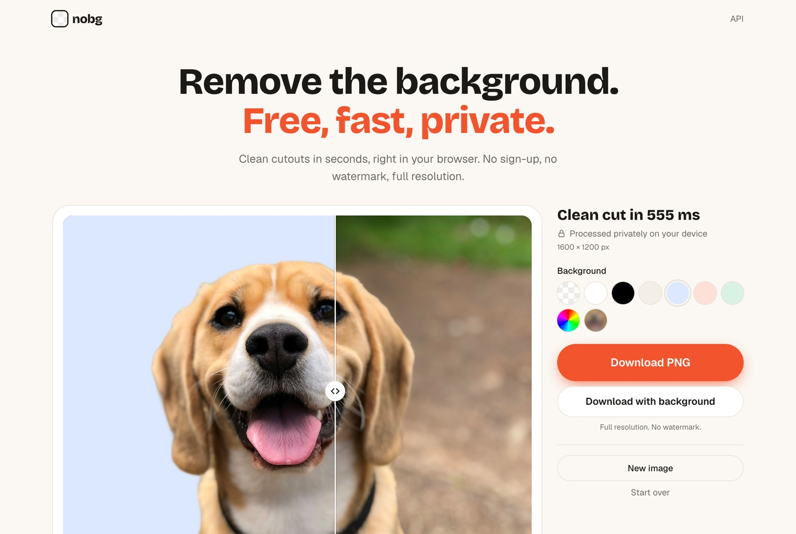

# nobg: free background remover that runs in your browser

**[nobg.here](https://nobg.here)** removes image backgrounds in under a second, right on your device. No sign-up, no
watermark, no upload (with WebGPU), and full resolution.

[](https://nobg.here)

- **Zero friction.** The landing page is the tool. Drop a file anywhere, paste with ⌘V, or try a sample.
- **Private by default.** With WebGPU (Chrome, Edge, Safari 26+), the AI model runs in your browser and your photo never
  leaves your machine. Older devices fall back to a server that processes in memory and keeps nothing.
- **Fast.** About 0.5 s for a typical photo and 1.3 s for a 12 MP phone shot on an M-series Mac after a one-time 90 MB
  model download.
- **Clean edges.** A matting model plus colour decontamination, so hair and fur don't get a halo.
- **Quick polish.** Before/after slider, and backgrounds that are transparent, solid, a custom colour, or a blur of the
  original. Download a PNG or a composite.
- **A small REST API** with a remove.bg-compatible `image_file` field, async jobs and per-key limits.
  See [nobg.here/developers](https://nobg.here/developers).

## How it works

```
browser ──(WebGPU)──> cutout on device             model: /models/*.bin (immutable, edge-cached by Cloudflare)
   └──(no WebGPU)──> api.nobg.here ─ Cloudflare Tunnel ─> nobg-tunnel ─(internal)─> nobg-api ─(internal)─> redis, postgres
```

| Layer | What |
|---|---|
| Web (`web/`) | Next.js and Tailwind on Vercel. The model runs in a Web Worker via ONNX Runtime Web (WebGPU). |
| Inference (`server/`) | FastAPI, ONNX Runtime (CPU), Redis rate limits and job queue, Postgres for keys and usage. Docker Compose on a small home server, reachable only through a Cloudflare Tunnel. |
| Model | [ISNet / DIS](https://github.com/xuebinqin/DIS) general-use (Apache-2.0). The browser gets an fp16 build (`tools/make_web_model.py`, reproducible and checksum-verified). |

The cutout pipeline is identical on device and server, and their outputs differ by less than 1/255 in alpha on average:

1. ISNet matte at 1024×1024.
2. Bilinear upscale of the matte to the original resolution (up to 16 MP).
3. Two-pass blur-fusion foreground estimation, which strips background colour spill from soft edges. The browser
   computes the smooth fields at ≤1024 px and combines them at full resolution, so memory stays low on phones.

Uploads go straight from the browser to the API, never through Vercel, whose function bodies are capped at 4.5 MB.

### Why not BiRefNet?

It's sharper on hair, but on a CPU-only home server it took 16 s and 6.8 GB of RAM per image. In the browser, ONNX Runtime
Web's WebGPU kernels exceed Chrome's 10-storage-buffer limit on BiRefNet's wide Split/Concat nodes. Rewriting those nodes
gets past that, but the model then runs out of WASM heap. `NEXT_PUBLIC_MODEL_URL` lets you swap the browser model without
code changes once that improves.

## Self-hosting the inference server

The stack is locked down because it parses untrusted uploads:

- `nobg-api` sits **only on internal Docker networks**. It has no route to the internet, your LAN or the host, and no
  published ports.
- `nobg-tunnel` (cloudflared) is the only container with egress, and it can reach only the API.
- Every container has a read-only root filesystem, `cap_drop: ALL`, `no-new-privileges`, a non-root user and
  memory/CPU/PID caps. The API is limited to 3 GB, 4 CPUs and 2 concurrent inferences, with up to 6 queued before it
  returns 503.
- Images live in RAM only. Async jobs keep input and result in Redis with a 1 h TTL.

```bash
echo 'NOBG_HOST=user@yourserver' > .env.deploy     # gitignored
./deploy.sh                 # rsync to ~/nobg on the server, fetch/build models, docker compose up
./deploy.sh --public        # same, plus the Cloudflare tunnel (TUNNEL_TOKEN in ~/nobg/.env)

# on the server, in ~/nobg
docker compose exec api python -m app.admin create-key you@example.com --plan personal --label laptop
docker compose exec api python -m app.admin list
docker compose exec api python -m app.admin revoke bg_live_AbCd
./smoke.sh photo.jpg out.png                       # test through the private network
docker compose --profile local up -d               # optional 127.0.0.1:8514 door for local development
```

**Tunnel:** Cloudflare Zero Trust → Networks → Tunnels → create one, then add the public hostname `api.<your-domain>` →
`http://nobg-api:8000`. Put the token in `~/nobg/.env` as `TUNNEL_TOKEN=`.

**State:** set `DATABASE_URL` in `.env` to Neon or Supabase to move Postgres off the box. The schema (`db/schema.sql`) is
applied on startup. To move to a VPS or GPU host, copy `.env` and run `./deploy.sh --public`. Two tunnel replicas can
overlap for a zero-downtime cutover.

## Web development

```bash
cd web && pnpm install && pnpm dev
```

Env: `NEXT_PUBLIC_API_URL` (default `https://api.nobg.here`) and `NEXT_PUBLIC_MODEL_URL` (default
`<api>/models/isnet-fp16-281bde9e.bin`). Add `?server` to the URL to force the server path.

## API

`POST /v1/remove` (multipart `image_file` or raw body), `POST /v1/jobs` and `GET /v1/jobs/{id}[/result]`, `GET /v1/usage`.
Keys look like `bg_live_…` and are stored only as SHA-256 hashes. Limits are Redis sliding windows per key (free 10/min and
100/day, personal 30 and 1,000, pro 60 and 10,000) and per IP for the web fallback (8/min, 60/day).
Full docs: [nobg.here/developers](https://nobg.here/developers).

## Credits

Model: ISNet / DIS by Xuebin Qin et al. (Apache-2.0), via the [rembg](https://github.com/danielgatis/rembg) ONNX export.
Sample photos: [Unsplash](https://unsplash.com).
